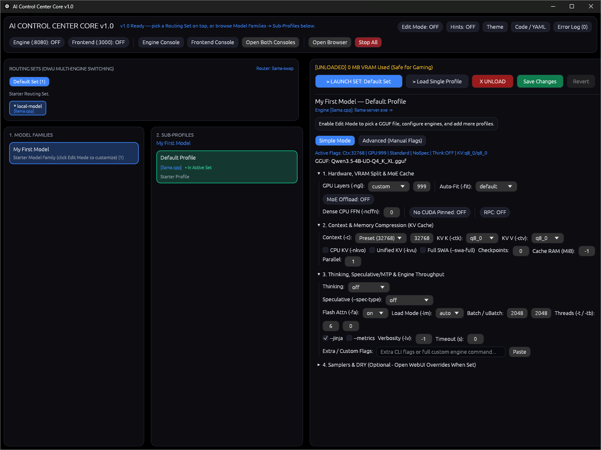
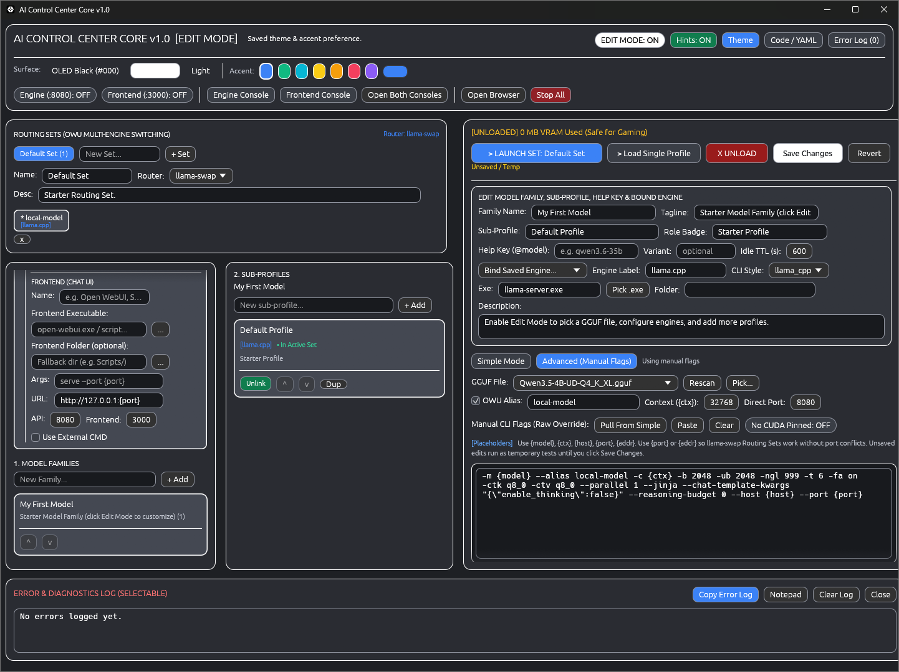
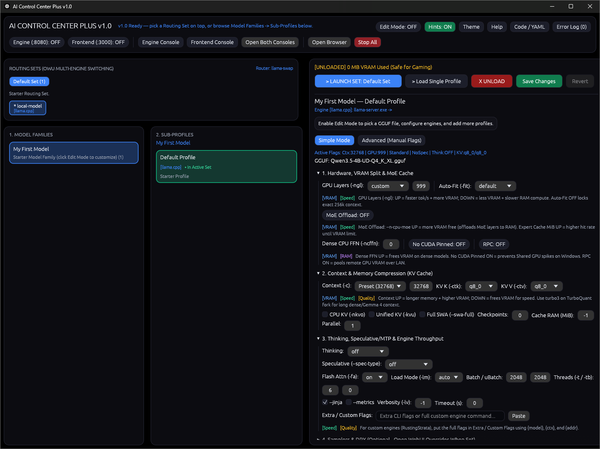
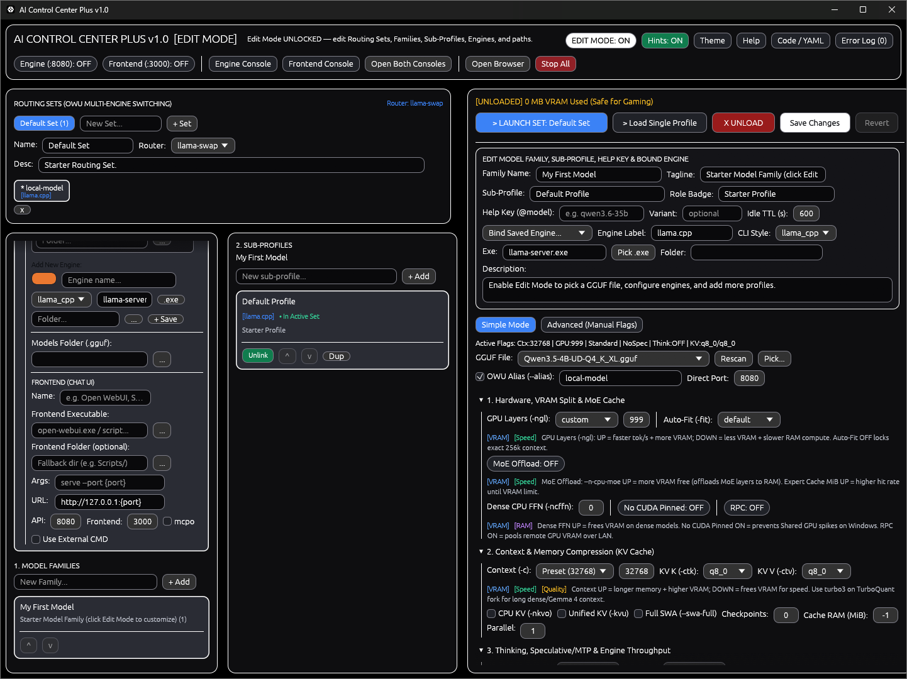
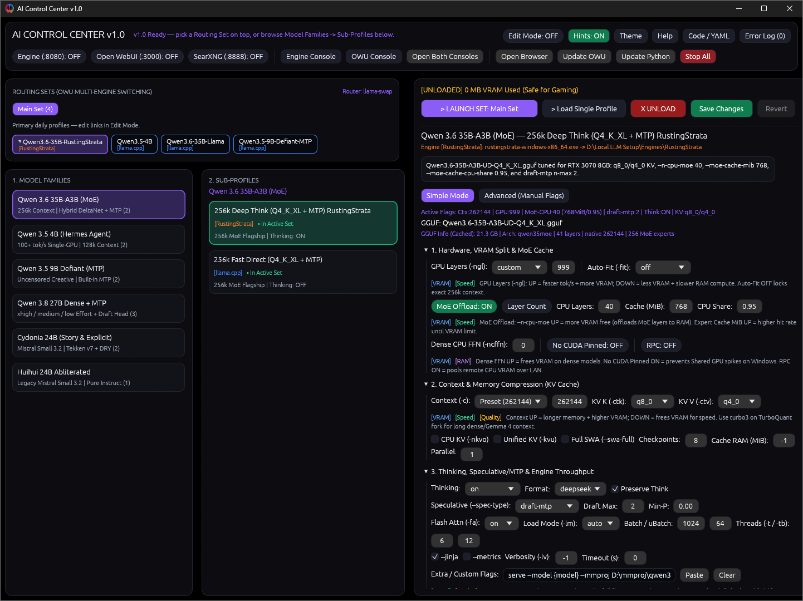

# AI Control Center (v1.0)

A fast, native desktop control panel for running local Large Language Models (LLMs) on **Windows** and **Linux**.

## Screenshots

### Core Edition





### Plus Edition





### Example: Fully Configured Plus Setup
*What Plus can look like in daily use once you add your own models, engines, companion services, scripts, and notes:*



### Proof: Live Model & Cross-Engine Hot-Swapping (Single Chat Session)
*One continuous chat showing **Qwen 4B** → **Qwen 9B** (hot-swapping models inside `llama.cpp`) → **4B model on `rustingstrata`** (switching both the inference engine and the loaded model on the fly through a single Routing Set):*


## Highlights

- **Native Rust Binary (`eframe` / `egui`):** Single portable executable with no Electron, Chromium, Python, or Node.js runtime overhead—fast startup and minimal idle RAM/VRAM usage.
- **Per-Profile Multi-Engine Binding & Custom Color Badges:** Register multiple inference engines side by side (mainline `llama.cpp`, experimental forks, or any custom CLI backend), assign each engine its own badge color and default launch template, and bind a specific engine to each profile. Switching profiles stops the active engine, frees VRAM, and launches the bound engine automatically.
- **Multi-Model Routing Sets (`llama-swap` + `llama.cpp` Router):** Group profiles—even across completely different engines—into one hot-swapping Routing Set via auto-generated `llama-swap.yaml` (with absolute path resolution and automatic `${PORT}` routing) or native `llama.cpp` `models.ini`.
- **Live Color-Coded CLI / YAML / INI Diff Viewer:** Every toggle updates a real-time command and config preview (added flags in green, modified values in amber, removed flags in red) so you always see the exact arguments before launching.
- **Direct Modern Tuning Controls:** First-class GUI controls for flags rarely exposed in mainstream desktop runners—including MoE expert offloading and expert VRAM caching, speculative/MTP decoding, KV cache quantization, DeltaNet context checkpoints, DRY sampling, per-process `GGML_CUDA_NO_PINNED=1`, and LAN `--rpc` GPU pooling—paired with optional plain-English hints and hover tooltips.
- **Instant GGUF Header Inspection:** Reads model size, architecture, layer count, context length, and MoE expert count directly from `.gguf` headers without loading weights into memory.
- **Non-Destructive Live Consoles & Auto Error Capture:** Independent floating console windows for your engine and web frontend can be closed and reopened at any time without interrupting running servers, while critical errors (OOM, CUDA faults, invalid flags, missing custom ports) are automatically surfaced in a dedicated Error Log.
- **Clean Separation of Daily Use & Configuration:** Toggle **Edit Mode** to access the highlighted **SETUP** panel for paths, engines, frontend, and profiles; toggle it off for a clutter-free daily launcher with customizable themes and accent colors.

## Core vs. Plus

AI Control Center is available in two free editions—clearly labeled as **`AI Control Center Core v1.0`** and **`AI Control Center Plus v1.0`**:

| Feature | **Core** | **Plus** |
| :--- | :---: | :---: |
| Single portable executable (Windows & Linux) | ✅ | ✅ |
| Model Families, Sub-Profiles & Saved Engines Library (with color pickers & custom default args) | ✅ | ✅ |
| Multi-model Routing Sets (`llama-swap` YAML & `llama.cpp` Router INI) | ✅ | ✅ |
| Generic Frontend launcher (configured in Edit Mode) + `Open Browser` | ✅ | ✅ |
| Floating Live Engine & Frontend Consoles + Automatic Error Log | ✅ | ✅ |
| Live Color-Coded CLI / YAML / INI Diff drawer (`Code / YAML`) | ✅ | ✅ |
| Instant GGUF header inspection | ✅ | ✅ |
| Inline tuning hints, hover tooltips, Themes & Edit Mode | ✅ | ✅ |
| Remote GPU pooling toggle (`--rpc`) | ✅ | ✅ |
| **External `Help` notes drawer** (per-model & per-engine Markdown notes) | — | ✅ |
| **Companion Services** (clickable `ON/OFF` header pills for sidecar apps) | — | ✅ |
| **Quick-Action Scripts** (one-click terminal buttons for updaters/tools) | — | ✅ |
| **Optional `mcpo` MCP-to-OpenAPI proxy toggle** | — | ✅ |

- **Core:** Focused, minimal control panel for managing LLM engines, Routing Sets, and a web frontend.
- **Plus:** Everything in Core, plus integrated controls for sidecar services, custom terminal scripts, `mcpo`, and per-model Markdown notes.

## Quick Start (Windows & Linux)

### 1. Download & Extract

Download the archive for your OS and edition from the [Releases](https://github.com/BaidDSB/ai-control-center/releases) page:

- **Windows (64-bit):**
  - `ai-control-center-core-v1.0.0-win64.zip` (`AI Control Center Core v1.0.0.exe`)
  - `ai-control-center-plus-v1.0.0-win64.zip` (`AI Control Center Plus v1.0.0.exe` + `help.example.md`)
- **Linux (x64, Ubuntu 24.04 / `glibc 2.39`+):**
  - `ai-control-center-core-v1.0.0-linux-x64.tar.gz` (`ai-control-center-core-v1.0.0`)
  - `ai-control-center-plus-v1.0.0-linux-x64.tar.gz` (`ai-control-center-plus-v1.0.0` + `help.example.md`)

Extract to any writable folder (for example `C:\LocalAI\` or `~/ai-control-center/`).

> **Linux Runtime Libraries:** GTK3 is required for native file dialogs, and a clipboard utility enables the Copy/Paste buttons:
> ```bash
> # Ubuntu / Debian / Linux Mint
> sudo apt install libgtk-3-0 wl-clipboard xclip
> ```
> *(Wayland uses `wl-clipboard`; X11 uses `xclip` or `xsel`.)*

### 2. Portable Configuration

- **Writable directory:** Saves `control_center_config_v3.toml`, `llama-swap.yaml`, and `models.ini` right next to the executable using resolved absolute paths for a self-contained portable setup.
- **Read-only system directory** (e.g., `/usr/local/bin`): Automatically stores config and generated routing files in:
  - **Linux:** `~/.config/ai-control-center/`
  - **Windows:** `%APPDATA%\ai-control-center\`

### 3. Initial Setup

1. Launch **AI Control Center Core v1.0** or **Plus v1.0**.
2. Click **`Edit Mode`** in the top bar.
3. On a fresh install, the highlighted **`SETUP: Paths, Engines & Frontend`** (Core) or **`SETUP: Paths, Engines, Frontend & Plus`** (Plus) card opens automatically in the left sidebar. Set:
   - Your **Models Folder** (scanned recursively for `.gguf` files).
   - Your **Global Engines Folder** (containing `llama-server` / `llama-server.exe`) and optionally your **`llama-swap`** binary.
   - Any additional engines in the **Saved Engines Library** (with custom badge colors and optional `Args:` templates).
   - Your **Frontend (Chat UI)** settings (optional—e.g., Open WebUI or any local web UI).
4. Pick a `.gguf` file on the starter profile, click **`Save Changes`**, toggle **`Edit Mode`** off, and click **`LOAD`**.

---

## Part 1: Core Edition — Options & Controls

### Top Header Bar

| Control | Function |
| :--- | :--- |
| **Routing Set / Engine (`:8080`)** | Starts or stops the active LLM backend; highlights green when running. |
| **Frontend (`:3000`)** | Starts or stops the configured web chat UI; highlights green when running. |
| **Engine Console / Frontend Console** | Opens or hides floating live log windows. Closing a console window leaves the running server untouched. |
| **Open / Close Both Consoles** | Toggles both console windows together. |
| **Open Browser** | Launches your configured frontend URL (default `http://127.0.0.1:3000`) in your system browser. |
| **Stop All** | Stops the active LLM backend, frontend, and any running services to release VRAM and RAM. |
| **Theme** | Opens the theme bar for switching presets (including OLED Black) and accent colors. |
| **Edit Mode** | Reveals the highlighted **SETUP** card and controls to add, delete, rename, and reorder Routing Sets, Model Families, Sub-Profiles, Engines, and paths. |
| **Hints: ON/OFF** | Toggles inline plain-English tuning summaries inside the Inspector. Hover tooltips stay available in either state. |
| **Code / YAML** | Opens the right-hand preview drawer showing the generated CLI command, `models.ini`, or `llama-swap.yaml`, complete with live diffs for unsaved changes. |
| **Error Log (`N`)** | Collects critical server errors (OOM, CUDA errors, invalid flags, startup failures) and highlights red when entries exist. |

### Main Workspace (50 / 50 Split)

- **Left Half — Routing Sets, Model Families & Sub-Profiles**
  - **Routing Sets (Top):** Bundles multiple Sub-Profiles into one launchable hot-swap set.
  - **Model Families (Bottom-Left):** Groups related configurations under one model heading (with the highlighted **SETUP** card pinned at the top when in Edit Mode).
  - **Sub-Profiles (Bottom-Right):** Individual presets under the selected family (e.g., different context sizes, engines, or sampling profiles), each tagged with its engine's badge color.
- **Right Half — Profile Inspector**
  - **`LOAD` / `UNLOAD`:** Launches the selected Sub-Profile directly or stops the active backend to free VRAM.
  - **`Save Changes` / `Revert Unsaved`:** Persists edits to `control_center_config_v3.toml` or discards unsaved changes.
  - **GGUF Info Summary:** Displays file size, architecture, layer count, max context, and MoE expert count read directly from the `.gguf` header.

### Inspector Tuning Sections

#### 1. Hardware, VRAM Split & MoE Cache

- **GPU Layers (`-ngl`):** Number of model layers placed on the GPU. Higher values increase speed and VRAM usage; lower values shift layers to system RAM and reduce VRAM usage. (`auto` or `999` offloads all layers.)
- **Auto-Fit (`-fit`):** `on` lets `llama.cpp` trim layers or context automatically to fit available VRAM; `off` enforces exact `-c` and `-ngl` values.
- **MoE Offload:** For Mixture-of-Experts models. Keeps shared/attention layers on GPU while placing routed experts in system RAM.
- **No CUDA Pinned:** Sets `GGML_CUDA_NO_PINNED=1` on the launched server process to avoid Windows Shared GPU Memory spikes on tight-VRAM cards.
- **RPC (`--rpc`):** Connects to a remote machine running `ggml-rpc-server` to pool extra GPU VRAM over LAN.

#### 2. Context & Memory Compression (KV Cache)

- **Context (`-c`):** Conversation and document memory length in tokens (~0.75 words per token). Higher values increase KV VRAM usage.
- **KV K / KV V (`-ctk` / `-ctv`):** Precision format for the KV cache.
  - `f16` / `q8_0`: Higher precision, larger VRAM footprint.
  - `q4_0` / `iq4_nl`: Significantly smaller VRAM footprint for long contexts.
- **CPU KV (`-nkvo`):** Keeps the KV cache in system RAM instead of VRAM (reduces VRAM usage at the cost of generation speed on long contexts).
- **Parallel (`--parallel`):** Number of concurrent generation slots. `1` dedicates full context and VRAM to a single stream.

#### 3. Thinking, Speculative Decoding & Speed

- **Thinking / Effort:** Controls built-in reasoning on supported models (`on`/`off` or effort tiers such as `low`/`medium`/`xhigh`).
- **Format (`--reasoning-format`):** Controls how `<think>` blocks are formatted (e.g., `deepseek` for collapsible reasoning blocks in compatible frontends).
- **Speculative / MTP:** Enables multi-token prediction or n-gram draft decoding for faster generation on supported models.
- **Flash Attention (`-fa`):** Accelerates attention and enables quantized KV cache formats (`q8_0`/`q4_0`).
- **Threads (`-t` / `-tb`):** `-t` sets token generation CPU threads (typically matched to physical cores); `-tb` optionally sets batch/prefill threads (up to logical thread count).
- **`--jinja`:** Enables the GGUF's embedded Jinja chat and tool-calling template.
- **Extra / Custom Flags:** Appends arbitrary CLI flags (or defines the full command template for `custom` engines). Supports `Paste`, `Clear`, and quoted paths containing spaces.

#### 4. Samplers & DRY *(Collapsed by Default)*

When toggled ON, appends server-side sampling flags (unless already provided in `Extra Flags`):

- **Temp (`--temp`):** Lower values (`0.2`–`0.6`) produce more deterministic output; higher values (`0.7`–`1.2`) increase variety.
- **Min-P / Top-P / Top-K:** Token probability cutoffs for filtering low-likelihood candidates.
- **Presence / Repeat Penalty:** Reduces repetition and topic looping.
- **DRY (`--dry-multiplier`, `--dry-base`, `--dry-allowed-length`):** Penalizes repeated multi-token sequences in long outputs.

### Saved Engines Library (Edit Mode)

Under **Edit Mode → highlighted `SETUP` card**, you can register multiple engine binaries (different `llama.cpp` versions, specialized forks, or custom servers):

- **Per-Engine Color Picker:** Click the color square next to any saved engine (or when adding a new engine) to choose its badge color across Routing Sets, Sub-Profiles, and the Inspector. Unset engines automatically receive distinct colors from a built-in 8-color palette.
- **Custom Engine Default Args (`Args:`):** When an engine's mode is set to `custom`, a default argument template field appears (pre-filled with `serve --model {model} --ctx {ctx} --addr {addr}`). Binding that engine to a Sub-Profile with blank flags automatically copies the template over.

---

## Part 2: Plus Edition — Additional Features

All Plus controls live under **Edit Mode → `SETUP: Paths, Engines, Frontend & Plus`** and stay hidden in the header until configured.

### 1. External `Help` Notes Drawer

- Click **`Help`** in the header to open a slide-out Markdown notes panel in the right drawer (tabbed alongside **`Code / YAML`**).
- Displays **General** notes for the selected model family and **Engine-specific** notes for the bound engine (color-coded to match your engine's chosen color).
- Includes **`Edit`** (opens `help.md` in your default editor) and **`Reload`** (re-reads from disk live).
- Ships with `help.example.md` demonstrating the comment-tag syntax.

### 2. Companion Services (Header `ON/OFF` Pills)

Manage background sidecar services (such as local web search engines, TTS servers, image generators, or RAG backends) directly from the header bar.

- **Configuration:** Open **`Edit Mode`** → **`SETUP: Paths, Engines, Frontend & Plus`** → **`Companion Services`** → **`+ Add Service`**.
- **Fields per service:**
  - **Checkbox:** Shows or hides the toggle pill in the top header.
  - **Name:** Display label on the pill.
  - **Port:** Localhost TCP port polled every 2.5 seconds to show live **ON** (green) / **OFF** status.
  - **Start / Stop:** Paths to `.bat`, `.cmd`, or `.sh` scripts executed in the background.
- Clicking **`Stop All`** stops all currently running Companion Services along with the LLM backend and frontend.

### 3. Quick-Action Scripts

Adds one-click buttons in the header for finite terminal tasks (updaters, database backups, `nvidia-smi` monitors, or health-check scripts).

- **Configuration:** Open **`Edit Mode`** → **`SETUP: Paths, Engines, Frontend & Plus`** → **`Quick-Action Scripts`** → **`+ Add Script`**, enter a button label, pick the script file, and click **`Save`**.

### 4. Optional `mcpo` Toggle

Enable the **`mcpo`** checkbox inside the Plus **SETUP** card (or set `enable_mcpo_toggle = true` in `control_center_config_v3.toml`) to add a clickable **`mcpo (:8000): ON/OFF`** pill to start and stop the `mcpo` MCP-to-OpenAPI bridge.

---

## Part 3: Advanced Reference

### 1. Custom Engines, Placeholder Expansion & `llama-swap` Port Safety

When an engine preset uses `custom` mode instead of `llama_cpp`, standard `llama.cpp` flags are skipped and **`Extra / Custom Flags`** (or the saved engine's **`Args:`** fallback) is passed directly to the bound executable with placeholder substitution:

| Placeholder | Value |
| :--- | :--- |
| `{model}` | Full resolved path to the selected `.gguf` file |
| `{ctx}` | Current Context (`-c`) value |
| `{host}` | Server host (e.g., `127.0.0.1`) |
| `{port}` | Server port (e.g., `8080`, or `${PORT}` inside `llama-swap.yaml`) |
| `{addr}` | Combined `host:port` |

Example:

```text
serve --model "{model}" --ctx {ctx} --addr {addr}
```

- **Quoted Paths:** Paths containing spaces are preserved automatically when arguments are split.
- **Automatic `${PORT}` Handling for `llama-swap`:** When generating `llama-swap.yaml`, AI Control Center automatically falls back to the saved engine's `Default Args` if a custom profile's flags are empty, rewrites hardcoded `--port` / `-p` / `--addr` / `--listen` / `--bind` flags to `${PORT}`, and validates that `${PORT}` is present before launch—surfacing a clear message in **Error Log** instead of an unexplained `llama-swap` exit code `1`.

### 2. Routing Sets: `llama_swap` vs. `llama_router`

- **`llama_swap`:** Writes `llama-swap.yaml` to an absolute path in your config directory and runs `llama-swap -config <abs_path> -listen <host:port> -watch-config`. Supports mixing different engine binaries (`llama_cpp` and `custom`) inside the same Routing Set with automatic on-demand model switching.
- **`llama_router`:** Writes `models.ini` to an absolute path and runs `llama-server --models-preset <abs_path> --models-max 1`. Native to `llama.cpp` without requiring `llama-swap`. Supports `--no-models-autoload` to defer loading until the first API request.

### 3. Additional Engine & Memory Flags

- **Auto-Fit Margin (`--fit-target`):** MiB of VRAM headroom reserved when Auto-Fit is `on` (default `1024`).
- **All CPU (`-cmoe`) vs. Layer Count (`--n-cpu-moe`):** `-cmoe` offloads every MoE layer to RAM; **Layer Count** offloads a specific number of layers so selected blocks (such as an MTP head layer) can remain on GPU.
- **MoE Cache (`--moe-cache-mib`) & CPU Share (`--moe-cache-cpu-share`):** Configures dynamic VRAM caching for hot MoE experts on builds supporting these flags. Higher `CPU Share` values compute cache misses on CPU rather than stalling PCIe transfers.
- **Dense CPU FFN (`-ncffn`):** Offloads dense feed-forward blocks to RAM while keeping attention layers on GPU.
- **KV & Memory Management:**
  - `-kvu` (**Unified KV**): Shares one KV buffer across parallel slots.
  - `--swa-full` (**Full SWA**): Retains expired sliding-window tokens for faster turn edits at higher VRAM cost.
  - `--ctx-checkpoints`: Saves recurrent/DeltaNet state snapshots for faster prompt rewinds when editing earlier turns.
  - `--cache-ram`: Caps host RAM prompt-prefix caching in MiB (`-1` = server default, `0` = disabled).
- **Load Mode (`-lm`):** Selects weight loading behavior (`auto`, `mmap`, `none`, `mlock`, `dio`).
- **KV Types (`turbo2`, `turbo3`, `turbo4`):** Supported on TurboQuant-patched `llama.cpp` forks; mainline `llama.cpp` uses `f16`, `bf16`, `f8_e4m3`, `q8_0`, `q4_0`, or `iq4_nl`.
- **Speculative Decoding (`--spec-type`, `--spec-draft-n-max`, `--spec-draft-p-min`, `--model-draft`):** Supports `draft-mtp` (built-in or external draft `.gguf`), `ngram-simple`, and `ngram-mod` when `parallel = 1`.
- **Diagnostics (`--metrics`, `-lv`, `--timeout`):** Enables `/metrics`, configures log verbosity (`-lv 0..4`), and adjusts HTTP timeouts for long prompt prefills.
- **Process Environment Isolation:** Enabling **No CUDA Pinned** injects `GGML_CUDA_NO_PINNED=1` solely into the spawned backend process without modifying OS environment variables. Companion Service scripts on Windows run with `CI=1` so scripts containing `if not defined CI pause` exit cleanly when launched headless.

### 4. Configuring Any Web Frontend

The Frontend button defaults to Open WebUI (`open-webui serve --port {port}`), and can be pointed to any local frontend binary or script directly in the UI via **Edit Mode → `SETUP` → `FRONTEND (CHAT UI)`** (Name, Executable, Folder, Arguments, URL, and Port).

You can also edit the same fields directly in `control_center_config_v3.toml`:

```toml
owu_port = 3000
frontend_name = "My Frontend"
frontend_exe = "/path/to/frontend-binary"
frontend_args = "serve --port {port}"
frontend_url = "[http://127.0.0.1](http://127.0.0.1):{port}"
```

### 5. `help.md` Tag Syntax (Plus Edition)

Notes in `help.md` are matched by **Help Key (`@model`)**, bound **Engine** (`llama_cpp` or `custom`), and optional **Variant (`@variant`)**:

```markdown
<!-- @model: my-model-32b | @engine: general -->
General notes shown across all engines for this model family.

<!-- @model: my-model-32b | @engine: llama_cpp -->
Engine-specific notes for llama.cpp profiles.

<!-- @model: my-model-32b | @engine: custom | @variant: fast -->
Notes shown when engine is `custom` and the profile's Help Variant is `fast`.

<!-- @model: * | @engine: llama_cpp -->
Global notes displayed for any profile using llama.cpp.
```

## Troubleshooting

- **Windows SmartScreen warning ("Unknown Publisher"):** Because the Windows executables are not commercially code-signed, SmartScreen may prompt on first launch. Verify your download against `SHA256SUMS.txt` and the VirusTotal reports on the [Releases](https://github.com/BaidDSB/ai-control-center/releases) page, then click **More info → Run anyway**.
- **Custom engine blocked before `llama-swap` launch (`no launch flags` / missing `${PORT}`):** Open **Edit Mode → `SETUP` → Saved Engines** and set `Args:` on your custom engine (or set **Extra / Custom Flags** on the profile) including `{model}` and `{port}` or `{addr}`, e.g. `serve --model {model} --ctx {ctx} --addr {addr}`.
- **`GLIBC` version error on Linux:** Pre-built Linux binaries are compiled on **Ubuntu 24.04 LTS (`glibc 2.39`)**. Older distributions below `glibc 2.39` (such as Ubuntu 22.04 or Debian 12) are not currently supported.
- **Copy / Paste buttons inactive on Linux:** Install `wl-clipboard` (Wayland) or `xclip` / `xsel` (X11).
- **Blank window inside a Linux VM:** Enable **3D Graphics Acceleration** in VM display settings, or launch with `LIBGL_ALWAYS_SOFTWARE=1 ./ai-control-center-core-v1.0.0`.
- **Closed console window:** Closing a console window does not stop the backend or frontend; click **`Engine Console`** or **`Frontend Console`** in the header to reopen it.

## License

Freeware — **All Rights Reserved**. Compiled binaries are free for personal and non-commercial use. See [LICENSE](LICENSE) for full terms.